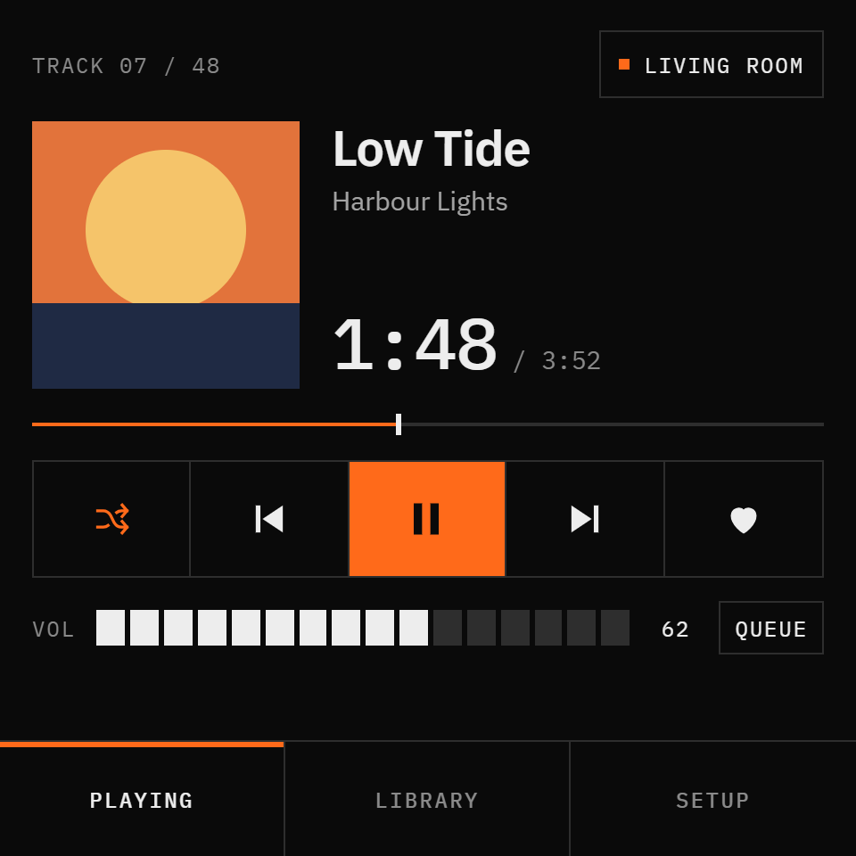
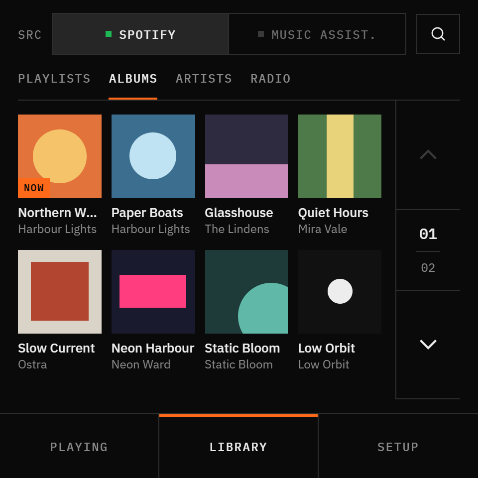
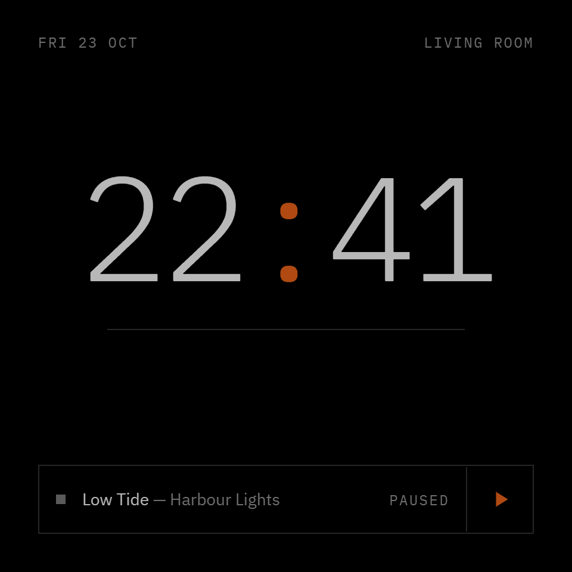

<p align="center"></p>

# MusicSpot

> 🚧 **Pre-release** — working on the author's panel, heading for 1.0. See [PLAN.md](PLAN.md) for progress.

A touch-panel music controller for Home Assistant: ESPHome + LVGL firmware for the
**Guition ESP32-4848S040** (4" 480×480 square display that fits a standard wall box),
with a HACS integration that connects each panel to a Spotify account.

<p align="center"><i>Skip the apps, not the songs.</i></p>

## Screens

<table>
  <tr>
    <td align="center"><br><sub>Now playing</sub></td>
    <td align="center"><br><sub>Library: albums</sub></td>
    <td align="center"><br><sub>Idle clock</sub></td>
  </tr>
</table>

<sub>Design renders; the firmware follows them closely (see <a href="design/">design/</a>). Photos of the panel follow with the 1.0 release.</sub>

## Features
- **Now playing:** album art, title and artist, track time and progress (tap to seek), play/pause,
  previous/next, shuffle, ♥ like, 16-step volume; controls react instantly
- **Library:** playlists (with Liked Songs), albums as a cover grid, followed artists, recently played;
  tap to play in context, long-press to add to the queue
- **Up next:** the current queue
- **Search** with an on-screen keyboard: tracks, albums, artists and playlists
- **Output:** pick the Spotify Connect speaker
- **Setup:** brightness, sleep timer (15–90 min with a volume fade), dim at night, clock-screen timeout
- **Idle clock** after a few minutes, and a boot splash that shows startup progress
- Several panels, each linked to its own Spotify account

## How it works
- **Firmware (`esphome/`):** a thin client — screens and touch only, no Spotify logic.
- **Integration (`custom_components/musicspot/`):** talks to the Spotify Web API, keeps browse state
  per panel, serves resized album art, and pushes updates to the panel through ESPHome API actions.

## Requirements
- Home Assistant with [HACS](https://hacs.xyz/)
- A Guition ESP32-4848S040 flashed with ESPHome
- Spotify Premium, and your own app in the [Spotify Developer Dashboard](https://developer.spotify.com/dashboard)

## Installing the integration (development builds)
1. HACS → ⋮ → **Custom repositories** → add `https://github.com/RubenKremer/esphome-musicspot`, type **Integration**.
2. Download **MusicSpot** from HACS and restart Home Assistant.
3. **Settings → Devices & services → Add integration → MusicSpot.** When asked, enter your Spotify app's
   Client ID and Client Secret (you can reuse the app from the core Spotify integration), then sign in.
4. **Link a panel:** on the MusicSpot account, click **Add panel** and pick the ESPHome device.
   Set **Album art base URL** to a plain-HTTP LAN address of Home Assistant (e.g. `http://192.168.1.2:8123`):
   HTTPS makes the panel freeze while images load. You can change it later with the panel's **Reconfigure**.
   The panel must have *Allow the device to perform Home Assistant actions* enabled.
5. Optional, to see what it polls: add to `configuration.yaml`
   ```yaml
   logger:
     logs:
       custom_components.musicspot: debug
   ```

## Known limitations (Spotify Web API)
- No true "play next": tracks can only be added to the end of the queue, and the queue can't be reordered.
- Development-mode Spotify apps allow at most 5 users.
- Devices may disappear from the device list while paused or idle. **Google Cast speakers** are the
  worst case: once playback moves away, Spotify stops offering them and transfers back fail. Start
  playback on the speaker once from the Spotify app and it becomes available again.

## Disclaimer
MusicSpot is an independent community project. It is not affiliated with or endorsed by Spotify,
ESPHome, the Open Home Foundation or Home Assistant. Spotify is a trademark of Spotify AB.

## License
[MIT](LICENSE)
